# Waddle

A web proxy you run yourself. Type an address and Waddle fetches the page through a proxy that it
found and tested on its own, so the site sees the proxy's address and a browser identity you chose
instead of yours.

Waddle never contacts a site directly. If no proxy is available, the page does not load and Waddle
says why.

No dependencies, no build step: `npm start`.

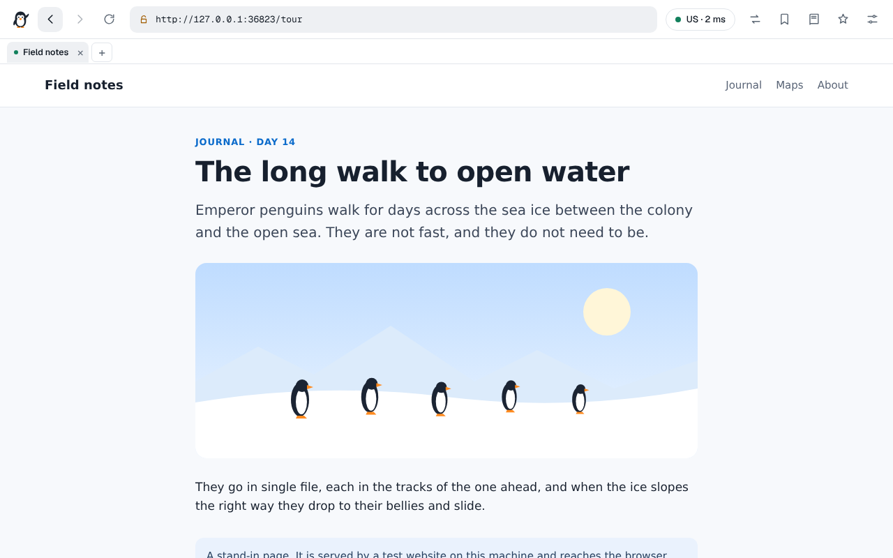

## Quick start

```sh
git clone https://github.com/wuzzynizzy/Waddle.git
cd Waddle
npm start
```

Open <http://localhost:8080>. Node 20 or newer is required; Waddle was developed and tested on Node 22.

Give it a minute on the first start. Waddle downloads its proxy lists and tests what they offer, and
the chip on the start page counts the proxies that passed. Pages load once it shows at least one.

| Variable          | Default     | What it does                                                                   |
| ----------------- | ----------- | ------------------------------------------------------------------------------ |
| `PORT`            | `8080`      | Port to listen on.                                                             |
| `HOST`            | `127.0.0.1` | Address to listen on. Use `0.0.0.0` to accept connections from other machines. |
| `WADDLE_PASSWORD` | none        | Ask every visitor for this password (HTTP Basic, user `waddle`).               |
| `WADDLE_DATA`     | `./data`    | Where settings and the proxy cache are kept.                                   |

The rest are in [docs/configuration.md](docs/configuration.md). If you expose Waddle beyond your own
machine, set a password and put it behind HTTPS: see [docs/security.md](docs/security.md).

### If nothing loads

Waddle reaches sites only through proxies, so it needs a network that lets it connect to them. Many
hosted sandboxes, preview environments and office networks do not. There the start page says
**This network blocks proxies**, and every address you open gives a page saying the same. That is
Waddle working as designed. Run it on a machine with ordinary internet access instead.

## What you get

**A proxy that feels like a browser tab.** Address bar, back, forward and reload. Links, forms,
redirects, scripts, styles, media, `fetch`, XHR, workers and WebSockets all stay inside the proxy.

**Proxies only.** There is no direct mode and no setting that creates one. With nothing to route
through, a site is never contacted.

**A proxy pool that looks after itself.** Waddle downloads proxy lists from 30 GitHub repositories
and 9 list addresses, searches GitHub and GitLab for new lists, and accepts any repository or list
address you add. Nothing is trusted until it has passed three tests:

- It carries an HTTPS request to a known page, which also tells Waddle the address and country sites
  will see.
- It returns known unencrypted pages unchanged. A proxy that changes one is dropped. One that
  cannot fetch them is kept for HTTPS only.
- It does not add headers that announce who is behind it. One that does never carries plain HTTP.

Working proxies are tested again every few minutes, and one that fails real requests is dropped.

**Routing you control.**

- A new exit per site, per request, or on a timer. One click for a new exit right now.
- Chains of up to five proxies, where only the last one learns which site you asked for.
- Exit country, entry country, protocol filter (HTTP, SOCKS4, SOCKS5), and per-site rules such as
  `example.com proxy US,DE hops=2` or `*.ads.example block`.
- A page and everything on it leave from one exit, so a site does not see one visitor arriving from
  several countries.
- A dead or refused exit (403, 429, 503) is swapped for another before you see an error.

**Name lookups that stay out of sight.** By default the exit proxy looks names up, so no lookup for a
site you visit leaves your machine. You can instead use encrypted DNS (DNS over HTTPS) resolvers,
asked through the exit: 13 are built in, any other can be added, and Waddle can keep a tested list
of public resolvers that promise no logs and no filtering. Ask them in order, race them, take turns,
give each site its own resolver, or cross-check two against each other.

**A different identity.** Twelve browser and system presets, a phone mode, or a new random identity
per session, per site or on a timer. Language, time zone and location can follow the country of the
exit, so they agree with the address the site sees. Screen, graphics card, processor, memory,
battery, fonts, canvas, WebGL and audio are covered. Request headers and what page scripts can read
always agree with each other. **What sites see** shows the result next to what your browser really
is.

**Less tracking.** Only the site in the address bar keeps cookies; a site embedded in someone else's
page gets none, and its own separate storage. Requests to 171 known tracking and advertising hosts
are refused before they leave. Plain `http://` addresses are upgraded to HTTPS. WebRTC is blocked.
**New identity** drops cookies, exits and the fingerprint in one go.

**Tabs and a local library.** Open up to 16 Waddle tabs, each with its own address and back/forward
history; links opened in a new window become Waddle tabs. Bookmark pages, sort bookmarks into
folders, and import browser-bookmark HTML or Waddle JSON. **Saved** keeps read-later addresses, not
offline copies. **History** is searchable. These records stay in this browser, not on Waddle's
server. New identity clears history and open tabs but keeps bookmarks and saved addresses.

**A start page that remembers.** Recommendations and address-bar matches come from this browser's
bookmarks, saved pages, history and open tabs. Nothing is sent to a search service for suggestions
by default. If enabled in Settings → General, DuckDuckGo suggestions are requested through the
current proxy exit.

**Inspect.** See recent requests with their site status, response size, duration, route and blocked
state, plus selected response headers, cookies for the current address and the page's rewritten
source. HttpOnly cookie values and `Set-Cookie` response values are hidden. The inspector's request
log is kept in memory for this Waddle session and is cleared by New identity.

**Frontend settings.** Choose an accent colour, interface density and text size; move the tab strip;
and show or hide start-page links, recommendations and status chips. These preferences are saved
only in this browser and do not change Waddle's server configuration. Keyboard shortcuts and the
panic key are listed in Settings → General.

**Its own pages when something fails.** Each failure has a short page that says what went wrong and
what to do. If the server itself cannot be reached, the tab shows a "Reconnecting" screen that
comes back by itself, never an unstyled error page from the host in front of it.

## The interface

The start page centers one search/address box. Local recommendations and quick links sit beneath it;
status chips show the pool, route, DNS and identity, and open the matching settings.

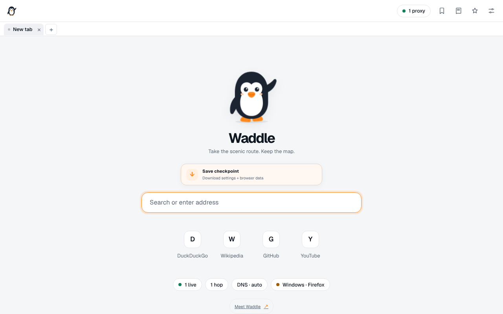

While browsing, the bar shows the real address, the country of the exit and how long the page took.
The arrows button asks for a new exit; the bookmark icon saves the current page; the book opens
Bookmarks, Saved, History and Inspect; the identity star starts a new identity; and the sliders open
settings. The tab strip keeps each open page and its back/forward history separate.

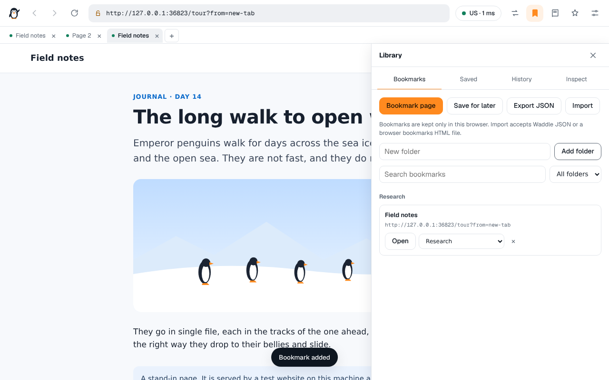

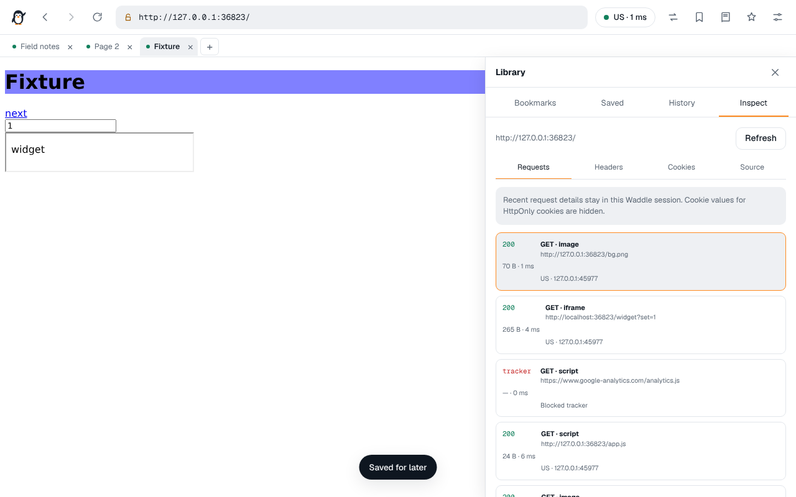

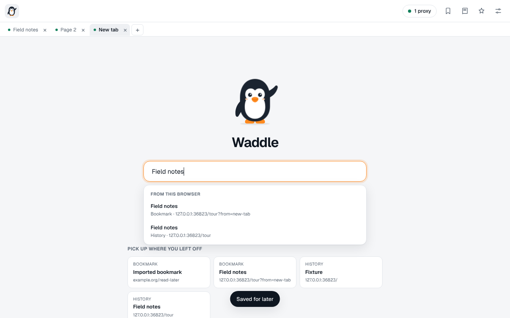

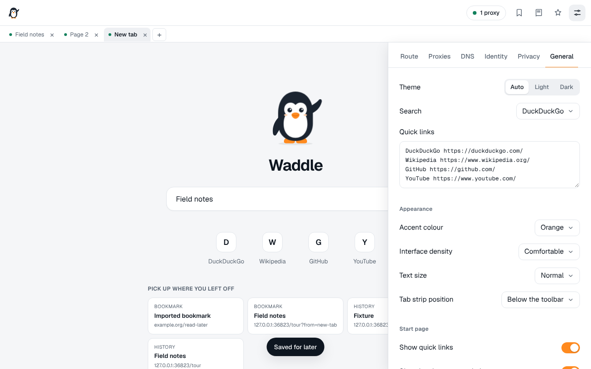

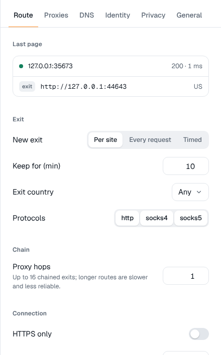 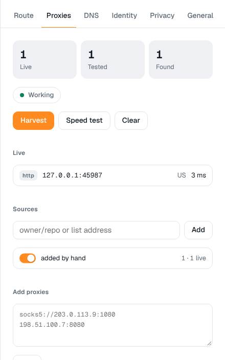 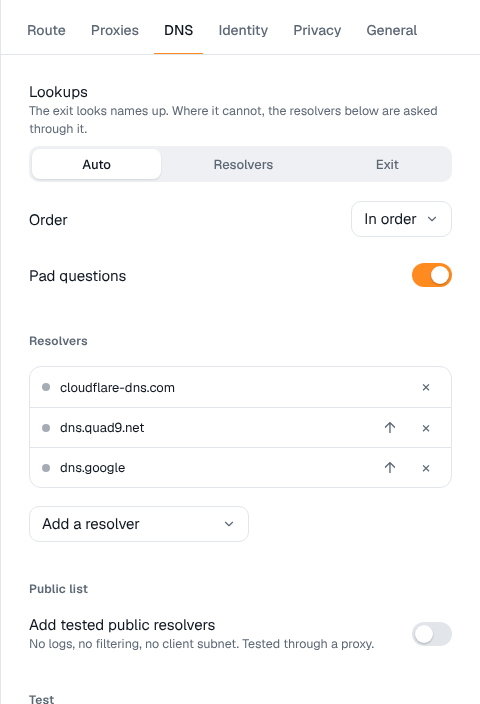

 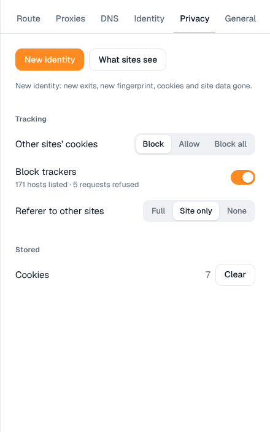 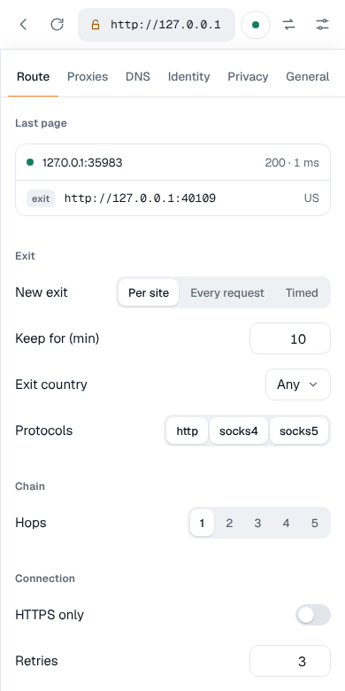

**What sites see** sets what a site reads next to what your browser really is:

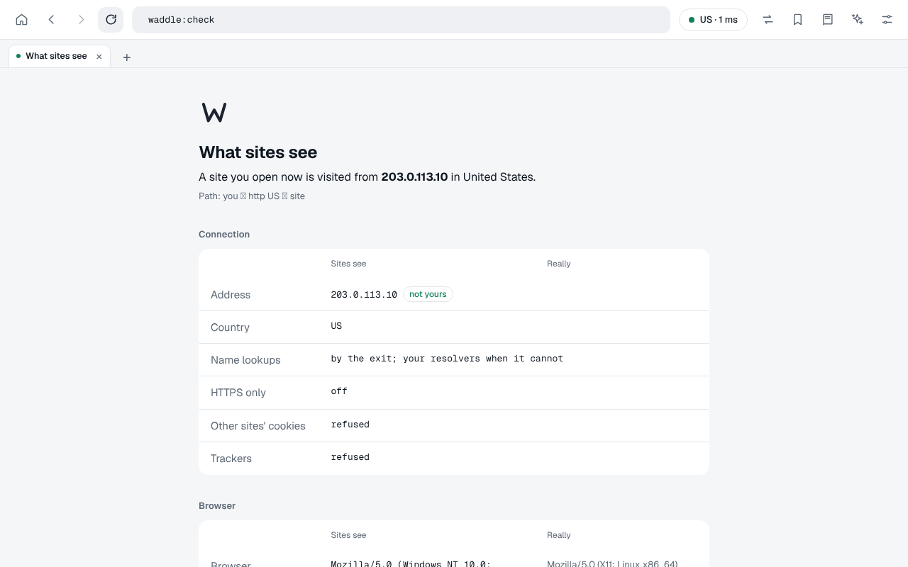

When a page cannot be loaded, Waddle says why and offers the next step:

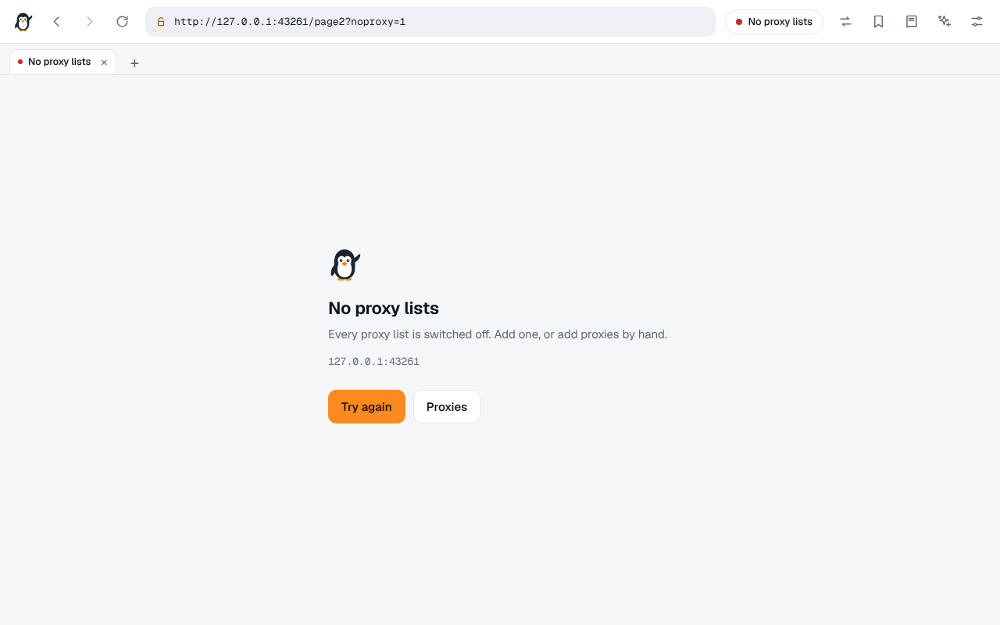 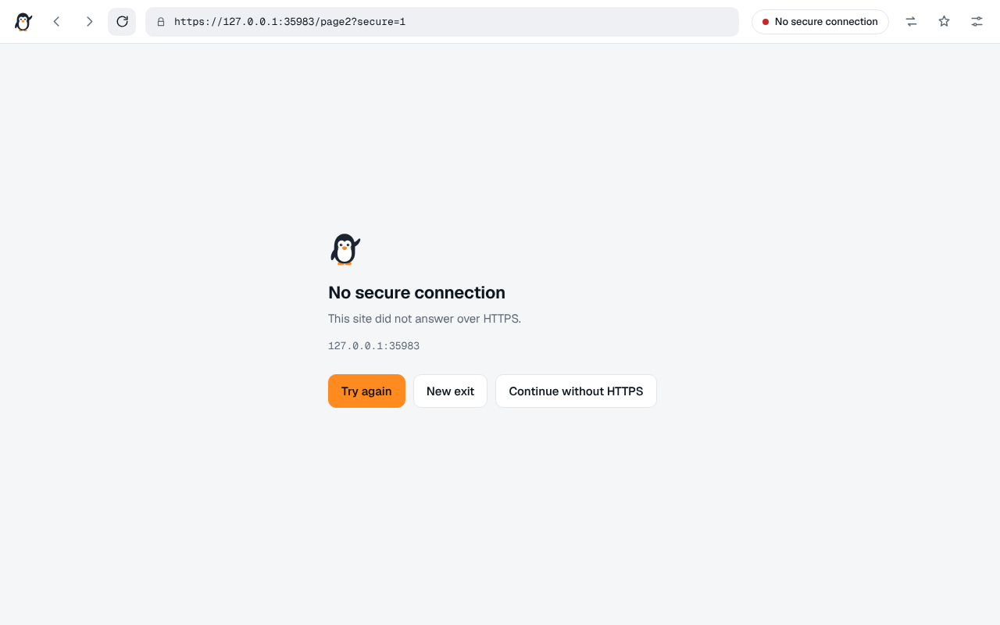

It works the same way on a phone, and in the dark:

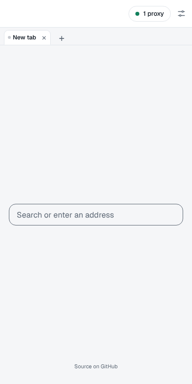 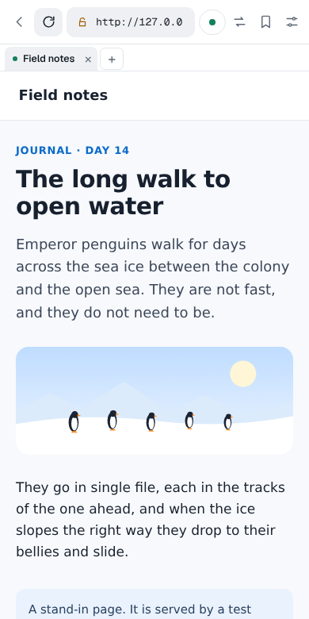

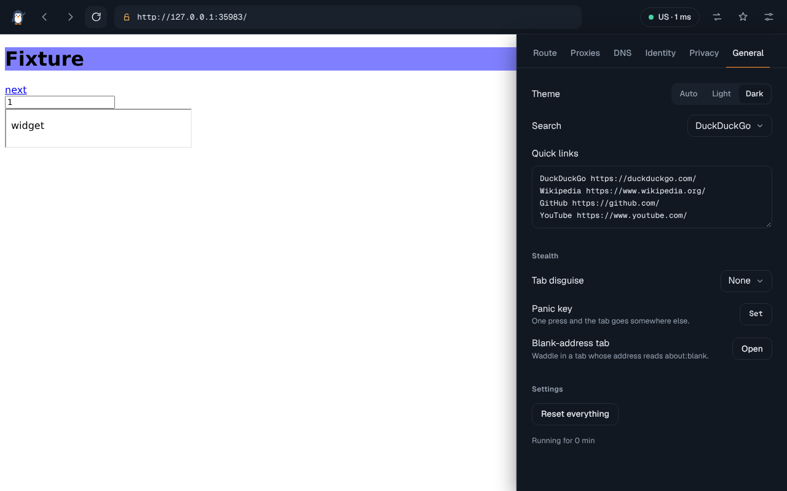

The screenshots come from the browser test, where the internet is replaced by stand-ins on the test
machine. The "site" is a test page and the exit is a test proxy that the test places in the United
States, which is why the addresses read `127.0.0.1`.

## How it works

```
browser ── Waddle server ── [entry proxy ── relays ──] exit proxy ── website
              │
              ├─ pool      harvest → test → vet → rotate → re-test
              ├─ resolver  names looked up by the exit, or over HTTPS through it
              └─ rewriter  HTML, CSS, JS imports, playlists
```

The server fetches each page through the pool, rewrites the addresses in it so that everything it
loads comes back through Waddle, and puts a small script first in the page. That script catches the
addresses a rewriter cannot see (the ones scripts build while running) and presents the chosen
identity. A service worker catches whatever is left. More in
[docs/architecture.md](docs/architecture.md).

## Tests

```sh
npm test              # 183 tests, about 30 seconds, no network needed
npm run test:browser  # 132 checks in a real Chrome (see docs/testing.md)
```

Both suites run the real server against stand-in websites, proxies (HTTP, SOCKS4, SOCKS5), DNS
servers and repository hosts on the local machine, and measure response times as well as
correctness. Details and measured figures are in [docs/testing.md](docs/testing.md).

## Limits worth knowing

- **No proxy, no page.** On a network that blocks outbound proxy connections, nothing loads.
- **Free proxies are slow, short-lived and run by strangers.** HTTPS sites are verified end to end, so
  a proxy cannot read or change them. A plain `http://` page can be read by every proxy on the way.
  Waddle only sends such pages through exits that passed its tamper test, and that test cannot
  promise an exit behaves the same for every page.
- **Not every site works.** Free proxy addresses are widely listed, so sites often answer them with a
  CAPTCHA or a refusal. Sites behind bot protection may refuse the request outright: Waddle changes
  the browser identity a site can read, not the network-level fingerprint of Node's TLS and HTTP
  stack. Sign-ins are unreliable.
- **Pages see Waddle's address.** Scripts that read `location` get Waddle's address, not the site's,
  which confuses some single-page apps.
- **All sites share one origin.** Every proxied site runs under Waddle's own address, so the browser
  does not separate them from each other or from Waddle's settings and browser-local library. A
  malicious page may reach data or controls that a normal website could not. Do not open untrusted
  sites in the same session as accounts or information that matter. See
  [docs/security.md](docs/security.md).
- **Waddle's own downloads start out direct.** The proxy lists come from GitHub and similar hosts,
  and until three proxies are live they are fetched straight from the machine Waddle runs on. So are
  the lookups for those hosts. No site you visit is ever reached that way. With a chain, the entry
  proxy sees the address of the machine Waddle runs on.
- **No HTTP/2 or HTTP/3 to sites.** Requests go out as HTTP/1.1.

## Documentation

- [Architecture](docs/architecture.md): how a request travels, how the pool works
- [Configuration](docs/configuration.md): environment variables and every setting
- [HTTP API](docs/api.md): what the settings panel talks to
- [Testing](docs/testing.md): what is covered, measured timings, how to run the browser test
- [Security](docs/security.md): what Waddle protects, what it does not
