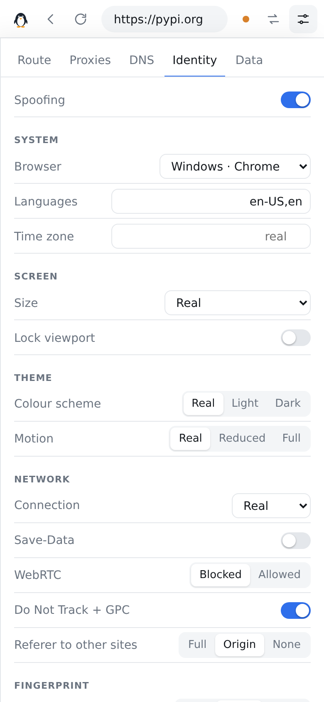

# Waddle

A minimal web proxy you run yourself. Type an address, and Waddle fetches the page for you through a
rotating pool of free proxies that it finds, tests and replaces on its own. Chains of up to three
proxies, encrypted DNS and a spoofed browser identity are a click away.

No dependencies, no build step: `npm start`.


## Quick start

```sh
git clone https://github.com/wuzzynizzy/Waddle.git
cd Waddle
npm start
```

Open <http://localhost:8080>. Node 20 or newer is required; Waddle was developed and tested on Node 22.

| Variable          | Default     | What it does                                                                  |
| ----------------- | ----------- | ----------------------------------------------------------------------------- |
| `PORT`            | `8080`      | Port to listen on.                                                            |
| `HOST`            | `127.0.0.1` | Address to listen on. Use `0.0.0.0` to accept connections from other machines. |
| `WADDLE_PASSWORD` | none        | Ask every visitor for this password (HTTP Basic, user `waddle`).              |
| `WADDLE_DATA`     | `./data`    | Where settings and the proxy cache are kept.                                  |

The rest are in [docs/configuration.md](docs/configuration.md). If you expose Waddle beyond your own
machine, set a password and put it behind HTTPS: see [docs/security.md](docs/security.md).

## What you get

**A proxy that feels like a browser tab.** Address bar, back, forward and reload. Links, forms,
redirects, scripts, styles, media, `fetch`, XHR and WebSockets all stay inside the proxy. Sites see
the exit proxy's address and the identity you chose, not your browser's.

**A proxy pool that looks after itself.** Waddle downloads proxy lists from 20 GitHub repositories and
7 list URLs, searches GitHub for new lists, and accepts any GitHub or GitLab repository or list URL
you add. Nothing is trusted until it has carried a real request: every candidate is tested against a
judge page, working proxies are re-tested every few minutes, and a proxy that fails is dropped on the
spot.

**Routing you control.**

- Automatic (proxies, falling back to a direct connection), proxies only, or direct.
- A new exit per site, per request, or on a timer. One click for a new exit right now.
- Chains of two or three proxies, where only the last one learns which site you asked for.
- Country filter, protocol filter (HTTP, SOCKS4, SOCKS5), and per-site rules such as
  `*.example.com proxy US,DE hops=2` or `*tracker* block`.
- A dead or refusing exit (403, 429, 503) is swapped for another before you see an error.

**A DNS changer.** Names are resolved over encrypted DNS (DNS over HTTPS). Twelve resolvers are built
in and any other can be added; stack them in order, race them, or rotate between them. Each one can
be timed from the panel.

**A different identity.** Nine browser and system presets (or a random one per session, or your
own), with languages, time zone, screen size, colour scheme, connection type, WebRTC, Do Not Track,
referrer policy, and canvas, WebGL, audio, font and device fingerprints. Request headers and what
page scripts can read always agree with each other.

**A cookie jar on the server.** Each visitor gets a private jar; sites' cookies never reach your real
browser.

## The interface

The start page is a single box. The chips underneath show the state of the pool, the route, DNS and
identity, and open the matching settings.


While browsing, the bar shows the real address, how the last page was fetched and how long it took.
The arrows button asks for a new exit; the sliders button opens the settings.

|                                 |                                    |
| ------------------------------- | ---------------------------------- |
|     |    |
|         |  |

It works the same way on a phone:

  

The screenshots were taken inside a sandbox that blocks connections to proxies and to most
resolvers, which is why they show a direct route, no live proxies and two unreachable DNS servers.

## How it works

```
browser ── Waddle server ── [entry proxy ── relay ──] exit proxy ── website
              │
              ├─ pool      harvest → test → rotate → re-test
              ├─ resolver  DNS over HTTPS, cached
              └─ rewriter  HTML, CSS, JS imports, playlists
```

The server fetches each page, rewrites the addresses in it so that everything it loads comes back
through Waddle, and puts a small script first in the page. That script catches the addresses a
rewriter cannot see (the ones scripts build while running) and presents the chosen identity. More in
[docs/architecture.md](docs/architecture.md).

## Tests

```sh
npm test              # 135 tests, about 13 seconds, no network needed
npm run test:browser  # real Chrome against the real server (see docs/testing.md)
```

The suite runs the real server against stand-in websites, proxies (HTTP, SOCKS4, SOCKS5), DNS
servers and repository hosts on the local machine, and measures response times as well as
correctness. Details and measured figures are in [docs/testing.md](docs/testing.md).

## Limits worth knowing

- **Automatic mode can go direct.** When no proxy answers, the default mode fetches the page from the
  machine Waddle runs on, and the site sees that machine's address. The bar says `direct` when this
  happens. Choose "Proxies only" if a page should fail instead.
- **Free proxies are slow, short-lived and run by strangers.** HTTPS sites are verified end to end, so
  a proxy cannot read or change them. A plain `http://` site can be read and altered by any proxy on
  the way.
- **Not every site works.** Pages see Waddle's address in `location`, which confuses some single-page
  apps. Sites behind bot challenges may refuse the request. Waddle changes the browser identity that
  sites can read, not the network-level fingerprint of Node's TLS and HTTP stack.
- **All sites share one origin.** Every proxied site runs under Waddle's own address, so the browser
  does not separate them from each other or from Waddle's settings. Do not sign in to accounts that
  matter. See [docs/security.md](docs/security.md).
- **No HTTP/2 or HTTP/3 to sites.** Requests go out as HTTP/1.1.

## Documentation

- [Architecture](docs/architecture.md): how a request travels, how the pool works
- [Configuration](docs/configuration.md): environment variables and every setting
- [HTTP API](docs/api.md): what the settings panel talks to
- [Testing](docs/testing.md): what is covered, measured timings, how to run the browser test
- [Security](docs/security.md): what Waddle protects, what it does not
