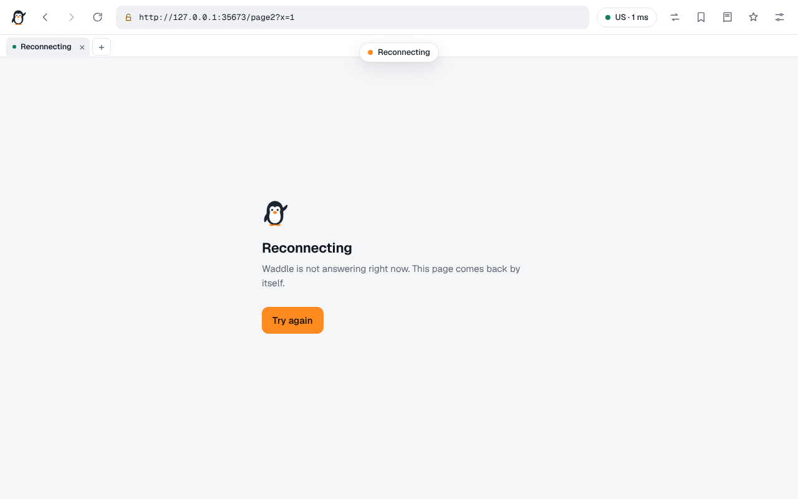

# Architecture

Waddle is one Node process with no dependencies. It serves a small browser interface, fetches
websites on the visitor's behalf, and keeps a pool of working proxies to fetch them through. It has
no way to fetch a site without one.

```
                       ┌────────────────────────── Waddle server ──────────────────────────┐
 browser               │                                                                   │
 ┌──────────────┐      │  server.js   routes, settings API, static files, access checks    │
 │ shell (/)    │─────▶│  proxy.js    one page request → upstream request → adapted reply  │
 │  └ iframe    │      │  rewrite.js  addresses in HTML, CSS, JS imports, playlists        │
 │    /~/<url>  │      │  cookies.js  one cookie jar per visitor                           │
 │ sw.js        │      │  pool.js     harvest, test, vet, rotate, chain                    │
 └──────────────┘      │  dns.js      DNS over HTTPS through a proxy, cache, health        │
                       │  net.js      HTTP / SOCKS4 / SOCKS5 tunnels, chains               │
                       └───────────────────────────────────────────────────────────────────┘
                                 │
                                 ▼
                  [entry proxy ─ relays ─] exit proxy ─ website
```

| File               | Role                                                                            |
| ------------------ | ------------------------------------------------------------------------------- |
| `server.js`        | HTTP server, routing, the settings API, access checks, start-up                 |
| `lib/proxy.js`     | Handles `/~/<url>` and WebSocket upgrades: routing, retries, blame, adaptation  |
| `lib/rewrite.js`   | Rewrites addresses in HTML, CSS, JavaScript imports, import maps, HLS playlists |
| `lib/pool.js`      | The proxy pool: sources, harvesting, testing, vetting, selection, chains        |
| `lib/extract.js`   | Finds proxies in any text: plain lists, URLs, CSV, JSON, HTML tables            |
| `lib/tar.js`       | Streaming tar reader for repository snapshots                                   |
| `lib/net.js`       | Outbound connections: through one proxy or a chain, always as a tunnel          |
| `lib/dns.js`       | DNS over HTTPS resolver with caching, health tracking and a tested public list  |
| `lib/cookies.js`   | Server-side cookie jars and visitor sessions                                    |
| `lib/config.js`    | Settings: defaults, validation, persistence, identity presets                   |
| `lib/geo.js`       | Countries: languages, time zones and a position for each                        |
| `lib/trackers.js`  | The list of tracking and advertising hosts                                      |
| `lib/pages.js`     | Waddle's own pages: errors, and "What sites see"                                |
| `public/index.html` | Browser shell with a minimal address/search start screen                     |
| `public/app.css`   | Shell and responsive browser-interface styling                                |
| `public/app.js`    | Browser shell: tabs, address bar, library, inspector and settings                |
| `public/local.js`  | Browser-local bookmarks, saved addresses, history and frontend preferences     |
| `public/client.js` | Script placed first in every proxied page and worker                            |
| `public/sw.js`     | Service worker: catches stray requests, hides a host's error pages              |

## Addresses

| Path                | What it serves                                                    |
| ------------------- | ----------------------------------------------------------------- |
| `/`                 | The interface. The page being viewed is kept in the URL fragment. |
| `/~/<absolute URL>` | A proxied resource, for example `/~/https://example.com/a?b=1`.   |
| `/~/f/<URL>`        | A document that a page embeds in a frame.                         |
| `/-/…`              | Waddle's own files and API (see [api.md](api.md)).                |
| `/<host>/<path>`    | Shortcut: `/example.com/news` opens that site in the interface.   |

## Browser shell state and inspection

Each Waddle tab keeps its address and navigation history separately in browser `localStorage` and
restores them when the shell reloads. The library and frontend preferences are also browser-local:
bookmarks and folders, searchable history, saved read-later addresses, appearance preferences, and
open-tab state. Saved items are URLs and titles, not downloaded page copies. Local address suggestions
match this library and open tabs; optional DuckDuckGo autocomplete is off by default and sends typed
queries through the current proxy exit when enabled. These browser-local records are not exported by
Waddle. The start screen itself contains only the address/search field and small project attribution.

The Inspector combines two sources. `lib/proxy.js` records a capped, newest-first log of recent
requests in each in-memory visitor session, including route, status, transfer counts, duration,
blocked/error reason and an allow-list of upstream response headers. `/-/api/inspect` returns that
log and cookie details for the selected URL; `Set-Cookie` values and HttpOnly cookie values are
redacted. The source view reads the current frame's live DOM in the browser, after the private Waddle
bootstrap has removed itself. Inspector records disappear on New identity, session expiry or server
restart. Details and field names are in [api.md](api.md#inspector).

All proxied pages and the shell still share one browser origin, so browser-local library data is not
a security boundary against a malicious page. See [security.md](security.md#one-origin-for-everything).

## Nothing leaves without a proxy

This is enforced at the bottom, in `lib/net.js`, and not by a setting:

- A request needs a proxy. One without is refused (`EDIRECT`), not sent.
- The only exception has to be asked for by name (`infra: true`). It is used for Waddle's own
  housekeeping: downloading proxy lists and the resolver list, and looking up the hosts those live
  on. No code path that handles a visited site sets it.
- Once three proxies are live, housekeeping downloads go through the pool as well.
- Every proxied connection is a tunnel (HTTP `CONNECT`, or SOCKS), also for plain HTTP. A proxy that
  is handed a request to forward can add headers to it, such as `X-Forwarded-For` with the caller's
  address. One that only carries bytes cannot.

When no proxy is available, `proxy.js` answers with a page that says so and why: still starting,
still searching, the network blocks proxies, no lists, no proxy that matches the filters, or no
proxy that is safe for plain HTTP.

## How a page request travels

1. The interface loads `/~/https://example.com/` in an iframe.
2. `proxy.js` checks the address. Private and local addresses are refused. A host on the tracker
   list is refused. A plain `http://` address is redirected to HTTPS when **HTTPS only** is on.
3. It works out the route: a routing rule if one matches, otherwise the route settings. It asks the
   pool for an exit, and relays for a chain.
4. Request headers are rebuilt from scratch for the site: the spoofed `User-Agent`, languages and
   client hints; the real `Origin` and `Referer` of the page that asked (mapped back from Waddle's
   addresses); cookies from the visitor's jar. Headers that would reveal the visitor or the proxy
   (`X-Forwarded-For`, `Via`, Waddle's own cookie and password) are never sent. Header names are
   spelled the way a browser spells them, also when something in front of Waddle lower-cased them.
5. `net.js` opens a tunnel through the chain. The exit is given the site's name and looks it up
   itself, or Waddle's resolvers are asked through the same route and the exit is given the address
   (see [DNS](#dns)).
6. If the attempt fails, another exit is tried, up to `route.retries` more (see
   [Retries and blame](#retries-and-blame)).
7. The reply is adapted:
   - `Set-Cookie` goes into the jar and is not passed to the browser.
   - Redirects are pointed back into the proxy.
   - Headers that would break framing or pin the browser to the real site (CSP, `X-Frame-Options`,
     HSTS, COOP/COEP/CORP, reporting headers, `Alt-Svc`) are removed.
   - HTML, CSS, JavaScript and HLS playlists are decoded (gzip, deflate, Brotli; any declared
     character set) and rewritten; everything else is streamed through byte for byte, with range
     requests and validators intact.
8. For HTML, the page script is inserted as the first thing in `<head>`, carrying the identity for
   this visitor and this site.

### One exit per page

A site that sees one visitor arrive from three countries within a second has learned something. So
a page and everything on it leave from the page's exit:

- The exit is kept per site (`route.rotate: sticky`), for `route.minutes`. With `timed`, one exit
  serves every site.
- A second try borrows another exit without moving the site. The site moves only when a page
  actually loads on the other exit.
- A third party on the page (a font host, a video CDN) uses the page's exit too. If it cannot,
  because a rule sends it elsewhere, the exit may not carry plain HTTP, or the third party turns
  that exit away, it gets an exit of its own. What is learned about that pairing is kept apart from
  the site's own record.
- **New exit** for a site takes its third parties along.

### Retries and blame

Free proxies fail all the time, and so do sites. Telling the two apart matters: evict good proxies
for a dead site and the pool empties; forgive bad ones and every page is slow.

- A failure that is certainly the proxy's (it would not connect at all, it spoke nonsense, it asked
  for a password) counts against it at once.
- Any other failure counts against an exit only if a later attempt at the same request reaches the
  site through another exit. If nobody reaches the site, the site is the problem.
- A relay that refuses to connect onward is marked and used only as an exit from then on. The chain
  is rebuilt around it, and after two such detours it gets one hop shorter (`route.shorten`).
- A document answered with 403, 429 or 503 is tried through the next exit. When every exit gets the
  same answer, the site's answer stands.
- A request with a body that may already have been sent is never sent again.
- A proxy is evicted after three failures in a row, or five since it last carried anything.

### Connections

Connections through proxies are kept open and reused, which is most of why a second request
through a three-proxy chain costs about the same as the first through one. Two things follow from
that, both handled in `net.js`:

- **A reused connection may already be dead.** Servers and proxies close idle connections without
  notice, and the first sign is a reset on the next request. When that happens on a connection that
  had been used before, the request is repeated once on a new connection, as browsers do. A reset on
  a connection that was new is a real failure and is reported.
- **A name may have an address that does not work.** For Waddle's own direct downloads: when a host
  has several addresses and the connection to one is cut off before the request could be sent, that
  address is put at the back of the queue for ten minutes and the request is made again on the next
  one.

## Keeping a page inside the proxy

Three layers, each catching what the previous one cannot:

1. **Server-side rewriting.** Addresses in HTML attributes (`href`, `src`, `srcset`, `action`,
   `poster`, inline styles, `<meta refresh>`, import maps), in CSS (`url()`, `@import`) and in
   JavaScript `import` statements are rewritten as the document passes through. The scanners are
   single forward passes with bounded matching, so a hostile page cannot stall the server.
2. **The page script** (`public/client.js`). JavaScript builds addresses while it runs, where no
   rewriter can see them. The script wraps the places they are used: `fetch`, `XMLHttpRequest`,
   `WebSocket`, `EventSource`, `sendBeacon`, workers, element properties such as `img.src`, elements
   added to the page later, `history`, `window.open`, form submission and `document.cookie`. It also
   hides the fact that the page is inside a frame, and gives each site its own `localStorage`,
   `sessionStorage` and IndexedDB names, since all sites share Waddle's origin. Workers get the same
   script put in front of their code.
3. **A last line.** If the service worker (`public/sw.js`) controls the page, any request that still
   points outside is sent back through the proxy. If it does not (it is not installed yet, or the
   browser does not allow it), a Content-Security-Policy confines the page to Waddle's own address,
   so a stray request is refused rather than sent from the visitor's browser.

What is not hidden: `location` inside the page shows Waddle's address. Rewriting every script to
hide that is slow and fragile, and Waddle does not attempt it. Some single-page apps route on
`location.pathname` and misbehave as a result.

### Embedded documents

A document in a frame is addressed as `/~/f/<url>`, so the server can tell it from a page opened in
the address bar. It runs with the identity of the page that embeds it. Under the default cookie
policy it gets no cookies, and its storage is kept apart from what the same site stores when it is
visited itself.

## When the server cannot be reached

Hosts and CDNs put their own page in place of a 502 or 504 from the app behind them, and show one
when the app does not answer at all. That page is not Waddle's, and inside a proxy its own
stylesheet would be requested through the proxy and fail. Two measures keep it out of sight:

- Waddle never answers with a status that gets replaced (502, 504, 520 to 530). A failed document is
  sent as 200 with Waddle's own error page, and the real status travels in `X-Waddle-Status`.
- Every answer from Waddle carries `X-Waddle: 1`. The service worker looks at each page before it
  is shown. One without the header, or no answer at all, is replaced with a "Reconnecting" screen
  that asks `/-/ping` until the server is back and then loads the page.

The interface's own files are cached by the service worker, so it still opens while the server is
away.



## The proxy pool

```
sources ──▶ harvest ──▶ candidates ──▶ judge ──▶ tamper check ──▶ live pool ──▶ routes
   ▲            │                        ▲                            │
   └─ discovery ┘                        └────────── re-test ─────────┘
```

**Sources.** Three kinds, all editable in the panel:

- GitHub repositories. The whole repository is downloaded as one snapshot (`codeload.github.com`)
  and read as a stream; list-like files (`.txt`, `.csv`, `.json`, `.list`, `.lst`, `.md`) are scanned.
  Files that hold other kinds of servers (V2Ray, Shadowsocks, Tor bridges and so on) are skipped.
- GitLab projects, the same way, through GitLab's archive API.
- Any address that returns a list: plain text, JSON, CSV or an HTML table.

**Extraction.** `lib/extract.js` finds `ip:port` in any of those formats, with credentials if
present. The protocol comes from the entry itself (`socks5://…`), else from the file's name or path
(`socks4.txt`), else every protocol is tried during testing. Private and reserved addresses are
discarded.

**Discovery.** After each harvest Waddle searches GitHub and GitLab for recently updated
repositories named or tagged as proxy lists, and adds up to `pool.discoverMax` of them as sources,
marked "found". A found source that keeps failing to download, or that yields no working proxy
after 600 tests, is dropped again and not re-added.

**Testing.** Nothing is used untested.

1. Each candidate has to fetch the judge page (`pool.judge`, by default Cloudflare's trace page over
   HTTPS). A pass proves the proxy can carry an HTTPS request without tampering, and the judge's
   reply gives the exit's public address and country.
2. It is then asked for pages whose content is known (`pool.canaries`). Delivered intact: it may
   carry plain HTTP. Changed, where other proxies deliver the same page intact: it is dropped. Not
   delivered at all: it is kept for HTTPS only.
3. A page that echoes request headers (`pool.echo`) shows whether the proxy adds any that announce
   the caller. One that does never carries plain HTTP.

`pool.concurrency` tests run at once; testing pauses once `pool.target` proxies are live and
resumes when the pool shrinks. Candidates from sources that have produced live proxies before are
tested first.

**Upkeep.** Live proxies are tested again every `pool.recheckMinutes`, and vetted again a few times
a day. The live list is saved to `data/pool.json`, so a restart begins with the proxies that were
working, re-tested. With `pool.adaptive`, lists are downloaded sooner while the pool is short and
later while it is full.

**Selection.** Among usable proxies (protocol and country filters applied), faster and steadier
ones are chosen more often, but all get traffic. An exit that worked for a site the last time is
preferred for that site.

**Chains.** With two to five hops, Waddle connects to the entry proxy, asks it to connect to the
next one, and so on; the last proxy connects to the site. Each proxy sees only its neighbours, and
for HTTPS the site's certificate is verified through the whole chain. With `route.spread` the hops
are put in different countries when the pool allows, and `route.entry` limits where the first one
may be.

**When nothing works.** If hundreds of candidates in a row fail, the network is probably blocking
outbound proxy connections. The pool pauses and retries later instead of burning through its list,
and its health reads `blocked`.

## DNS

Who looks up a site's name is a choice (`dns.mode`):

- **The exit does** (`auto`, `exit`). The tunnel is opened to the name, and the lookup happens at
  the exit. Nothing about it leaves the machine Waddle runs on.
- **Waddle's resolvers do** (`stack`). `lib/dns.js` speaks DNS over HTTPS (RFC 8484) to a list of
  resolvers, through the same proxy route the page will take. The resolver sees the exit's address,
  not Waddle's. The exit is then handed the address.

A question about a visited site is never asked directly, and never handed to the system resolver.
The direct path exists only for the hosts Waddle's own downloads live on.

The resolvers can be asked in order, raced, used in turn, split so that each site always goes to
the same one, or cross-checked against each other. Questions are padded to a fixed size (RFC 8467).
Answers are cached for the lifetime the resolver gives them, kept between 30 seconds and one hour;
"no such name" is cached too. A resolver that fails three times in a row is rested for a minute.

Behind the configured resolvers Waddle can keep a tested list of public ones (`dns.auto`). It
downloads the DNSCrypt project's list, keeps the resolvers that declare no logging and no filtering,
tests a sample through a proxy, leaves out any that invent answers, and keeps the quickest, one per
operator. The result is saved to `data/dns.json`.

## Identity

`lib/config.js` turns the identity settings into one consistent profile per visitor: request
headers (`User-Agent`, `Accept-Language`, client hints) and the values the page script reports
(`navigator`, `screen`, time zone, media queries, fingerprint surfaces) are generated from the same
source, so they cannot disagree. A page, its frames and its workers present the same one.

- Language, time zone and location can follow the exit's country (`lib/geo.js`), so they agree with
  the address the site sees.
- Browser version numbers are derived from the date, so presets do not go stale.
- Noise added to canvas and audio is derived from the session and the site: stable on one site,
  different on the next.
- The randomiser replaces the whole identity at once: per session, per site, or on a timer.

The built-in page **What sites see** (`waddle:check`) asks the pool's test page through the exit a
new site would get, and shows what a site reads next to what the browser really is.

What this does not change is the network-level fingerprint. Sites that inspect the TLS handshake
or HTTP framing see Node, whatever the `User-Agent` says.

## Cookies and sessions

Waddle sets one cookie of its own, `waddle`, which names the visitor's session. Each session has a
jar on the server that follows the browser rules for domain, path, `Secure`, `HttpOnly`, expiry and
public suffixes. Page scripts read and write cookies through the page script, which talks to the
jar; `HttpOnly` cookies are never shown to scripts. Jars are held in memory, bounded in size, and
dropped after a day without use.

By default only the site in the address bar keeps cookies (`privacy.cookies: first`). A site that
is only embedded in another's page neither receives nor stores any.

## Limits and safeguards

- Request bodies up to 32 MB are buffered so they can be replayed on another exit; larger ones are
  refused with 413.
- Documents up to 16 MB are rewritten; larger ones are streamed through untouched.
- Repository snapshots are capped at 25 MB compressed and 400 MB unpacked, list files at 8 MB, and
  the pool holds at most 150,000 untested candidates.
- Connections to private, loopback and link-local addresses are refused, for sites and for proxies
  (see [security.md](security.md)).
